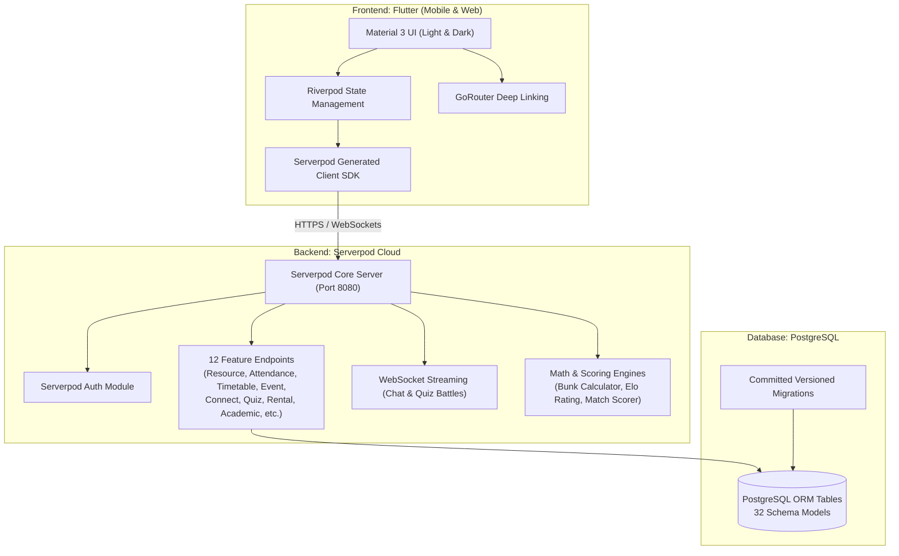

# 🚀 CampusPulse — The All-in-One Campus OS for Indian College Students

> **"One app for your whole college life: notes from seniors, attendance planner, timetable, events, communities, teammates and quiz battles."**

---

## 📌 1. Problem & Solution

### The Problem
Student life across 40,000+ colleges in India is fragmented and chaotic:
- **Scattered Communication**: Notes, timetables, and notices are buried in noisy WhatsApp groups and informal drives.
- **Untrusted Resources**: Freshers and juniors don't know whose notes to trust or which semester paper solutions are verified.
- **Attendance Anxiety**: Missing the strict 75% attendance criterion results in debarment or semester backlogs, yet students lack predictive clarity on how many classes they can safely miss.
- **Siloed Teammate Discovery**: Finding the right developer, designer, or study partner for hackathons, club projects, or competitions requires endless word-of-mouth outreach.

### The CampusPulse Solution
CampusPulse brings your entire campus ecosystem under a single, unified digital umbrella:
1. **Verified Notes & Resources Hub**: Peer-reviewed notes with uploader SGPA badges, follow counters, star ratings, and branch/year auto-filtering.
2. **Predictive Bunk-Meter**: Mathematical attendance engine calculating safe bunks, recovery classes, what-if scenarios, and one-tap daily logging.
3. **Smart Timetable & Calendar**: Personalized section timetable with active/upcoming class highlights and semester milestones.
4. **Instagram-Style Event Feed**: Vertically swipeable reels feed with live registration countdowns (turning red under 24 hours).
5. **Smart Teammate "Connect"**: Tinder-style swipe cards with algorithmic match scoring based on skills, branch, interests, and college proximity.
6. **Pokémon-Style Quiz Arena**: Real-time 1v1 and solo adaptive battles with Elo ratings, speed bonuses, and podium leaderboards.
7. **Peer Campus Rental Marketplace**: Rent scientific calculators, textbooks, lab kits, and laptops with mandatory consent protection.

---

## 🏗️ 2. Architecture & Tech Stack



### Strict Hackathon Stack Adherence
- **Frontend**: Flutter 3.47.9 (Stable), Material 3, Riverpod, GoRouter. Fully responsive for mobile and web.
- **Backend**: Serverpod 4.0.4 with typed models in `.spy.yaml`, PostgreSQL ORM, versioned migrations.
- **Hosting / Deploy**: Serverpod Cloud (`*.serverpod.cloud`) & Flutter Web.
- **Zero Forbidden Services**: 100% free of Firebase, Supabase, Node.js, Express, or Django.

---

## 📂 3. Monorepo Folder Structure

```
campuspulse1/
├── campuspulse_server/              # Serverpod Backend
│   ├── config/                      # development.yaml, production.yaml, passwords.yaml
│   ├── lib/
│   │   ├── server.dart              # Serverpod entry point
│   │   └── src/
│   │       ├── endpoints/           # 12 Serverpod endpoints
│   │       ├── generated/           # Serverpod ORM & models
│   │       ├── models/              # 32 .spy.yaml schema files
│   │       └── services/            # BunkCalculator, MatchScorer, EloRating, SeedService
│   ├── migrations/                  # Committed PostgreSQL migrations
│   ├── test/                        # 10/10 Logic & formula unit tests
│   └── pubspec.yaml
│
├── campuspulse_client/              # Generated Serverpod Client Package
│   ├── lib/
│   │   ├── campuspulse_client.dart
│   │   └── src/protocol/            # Typed endpoints & protocol models
│   └── pubspec.yaml
│
├── campuspulse_flutter/             # Flutter Client (Mobile + Web)
│   ├── lib/
│   │   ├── core/                    # Constants, Theme, Router, BunkMath, Network
│   │   └── features/
│   │       ├── auth/                # Login & Registration
│   │       ├── onboarding/          # <60-second Setup Wizard
│   │       ├── home_feed/           # Instagram-style Event Feed with Countdown
│   │       ├── study_hub/           # Notes Hub, Ratings, Comments, Uploads
│   │       ├── bunk_meter/          # Bunk Predictor & What-If Simulator
│   │       ├── timetable/           # Today, Week Grid, Academic Calendar
│   │       ├── connect/             # Teammate Swipe Posters & Chat
│   │       ├── quiz_arena/          # Battles, Elo Rating & Podium Leaderboards
│   │       ├── community/           # Clubs & Interest Circles
│   │       ├── rental/              # Campus Rental Marketplace
│   │       └── profile/             # LinkedIn-style Profile
│   ├── test/                        # 9/9 Bunk math & widget tests
│   └── build/web/                   # Production-ready Web Build
└── README.md
```

---

## ⚡ 4. How to Run & Test

### Prerequisites
- Flutter SDK (>=3.0.0)
- Dart SDK (>=3.0.0)
- Serverpod Cloud credentials for deployment (Docker is not required for local development)

### A. Run Serverpod Backend
```powershell
cd campuspulse_server
dart pub get
# Apply the committed migration to the embedded development database:
serverpod run migrate
# Start the backend:
serverpod run start
```

### B. Run Server & Logic Tests
```powershell
cd campuspulse_server
dart test
# 10/10 Tests will pass (Bunk Calculator, Match Scorer, Elo Rating, Edge Cases)
```

### C. Run Flutter App (Mobile or Web)
```powershell
cd campuspulse_flutter
flutter pub get
flutter test
# 9/9 Flutter Tests will pass

# Launch Web Application:
flutter run -d chrome
```

Debug builds connect to `http://localhost:8080/`. Release builds connect to
`https://api.campuspulse-2026.serverpod.cloud/`. To override the endpoint,
pass `--dart-define=SERVERPOD_URL=https://your-server.example.com/`.

---

## 🔑 5. Demo Credentials & Seed Data

The database includes a pre-seeded realistic Indian campus environment:
- **Colleges**: Indian Institute of Technology Delhi (IITD), Delhi Technological University (DTU)
- **Branches**: CSE, ECE, Mechanical
- **Sections**: CSE-3A, CSE-3B, ECE-2A
- **Demo Student Account**:
  - **Email**: `aarav.sharma@iitd.ac.in`
  - **Password**: `password123`
  - **Profile**: Year 3 CSE, SGPA 9.3, 6 notes uploaded, 4.9★ rating
- **Class Representative (CR) / Admin Account**:
  - **Email**: `priya.nair@iitd.ac.in`
  - **Role**: CR (Can schedule classes and add calendar deadlines)

---

## 🎙️ 6. 3-Minute Hackathon Demo Script

- **[0:00 - 0:30] The Hook & Problem**:
  > *"Every college student in India deals with chaos across WhatsApp groups. You don't know which notes to trust before exams, you accidentally drop below 75% attendance and get debarred, and finding a hackathon teammate is pure luck. Meet CampusPulse: the one operating system for your entire college life."*
- **[0:30 - 1:15] Hero Feature 1: Study Hub**:
  > *"When Aarav logs in, the Study tab immediately filters notes to 3rd Year Computer Science. Every resource shows the uploader's actual semester SGPA and a 'self-declared' badge. Notice Sahab Raza's DBMS notes: rated 4.9 stars by 34 students and used by 128 peers. Junior freshers instantly know what to study."*
- **[1:15 - 1:45] Hero Feature 2: Bunk-Meter (Attendance Predictor)**:
  > *"Under Bunk-Meter, our proprietary algorithm computes that with 21 out of 28 classes in OS, Aarav can safely bunk 0 classes. Watch our interactive What-If slider: 'If I bunk 2 more classes, my attendance drops to 70%—requiring 4 consecutive attended classes to recover.' One-tap buttons allow marking today's classes in a second."*
- **[1:45 - 2:15] Feature 3 & 4: Instagram Feed & Connect**:
  > *"The Home feed displays events as full-screen cards. Look at HackPulse 2026: a live countdown timer ticking down; turning crimson under 24 hours. Tapping Connect brings up Tinder-style posters with candidate match percentages based on skill overlap. A student can send a connection request with a 3-message pre-acceptance safety limit."*
- **[2:15 - 2:45] Feature 5: Quiz Arena & Rental**:
  > *"In Quiz Arena, students engage in Pokémon-style 1v1 trivia battles. Difficulty adapts via an Elo rating algorithm with speed bonuses for fast answers. The podium showcases the top 3 scholars in the college, branch, or year. Finally, our Rental Marketplace lets students rent lab equipment and scientific calculators with mandatory damage-liability consent."*
- **[2:45 - 3:00] Conclusion & Roadmap**:
  > *"Built strictly on Flutter and Serverpod. Production ready, tested, and built for India's 40 million college students. Thank you!"*

---

## 📊 7. One-Page Pitch Outline

| Dimension | Details |
|---|---|
| **Problem** | 40M+ Indian college students lose attendance, waste money on untrusted notes, and struggle to form teams due to fragmented WhatsApp group communication. |
| **Solution** | A unified campus OS combining peer-verified academic notes, predictive attendance calculators, live countdown event feeds, smart teammate matching, and quiz battles. |
| **Why It Wins (Unfair Advantage)** | Built-in trust architecture: self-declared SGPA badges linked to peer ratings, mathematical bunk protection with instant recovery calculations, and zero noise. |
| **Target Market** | **TAM**: ₹4,800 Cr Indian higher education student services market (41M undergrads across 43,000 institutions).<br>**SAM**: 12M Engineering, Tech, and Science students.<br>**SOM**: Top 150 Tier-1/2 institutes (IITs, NITs, BITS, DTU, VIT) with 450,000 active students. |
| **Monetization Roadmap** | 1. Sponsored hackathons and campus recruiter challenges (Quiz Arena).<br>2. Premium student rental deposit escrows.<br>3. College club and fest ticketing convenience fee. |
| **Next Steps** | Campus ambassador launch in 5 pilot institutes, integration of Serverpod cloud storage for instant PDF previews, and automated timetable OCR import. |
